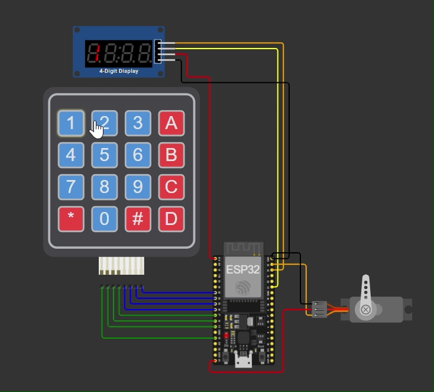

# ESP32 PIN Access System

Access system with keypad PIN entry, a 7-segment display (TM1637) and a servo-controlled locking mechanism. Runs as a simulation in Wokwi; the firmware is written for the ESP32.

## How It Works

The user enters a 4-digit PIN on the 4x4 keypad. The entered digits are shown live on the 7-segment display. After the fourth digit, the PIN is checked:

- **Correct:** The display shows `OPEn`, the servo turns to 90° (lock open) and closes again automatically after 3 seconds.
- **Wrong:** The display shows `Err` and the input is reset.

## Controls

| Key | Function |
|-----|----------|
| `0`–`9` | Enter digit |
| `#` | Delete last digit |
| `*` | Clear entire input |

The default PIN in the simulation is `1234`.

## Features

- PIN entry via 4x4 matrix keypad
- Live display of the input on the TM1637 (4 digits)
- Text feedback: `OPEn` on success, `Err` on a wrong PIN
- Servo as locking mechanism with automatic re-locking
- Correction functions (delete digit, clear all)

## Hardware

| Component | Connection to ESP32 |
|-----------|---------------------|
| ESP32 | – |
| 4x4 keypad | Rows = GPIO 13, 12, 14, 27   Columns = GPIO 26, 25, 33, 32 |
| TM1637 (7-segment) | CLK = GPIO 22, DIO = GPIO 21 |
| Servo | Signal = GPIO 23 |

## Setup

1. Open the project in [Wokwi](https://wokwi.com) (ESP32 project with the components listed above).
2. Use these libraries in the Arduino environment or in Wokwi:
   - `Keypad`
   - `TM1637Display`
   - `ESP32Servo`
3. Start the simulation and enter the PIN on the keypad.

## Configuration

The settings are at the top of the sketch:

| What | Variable | Default |
|------|----------|---------|
| PIN | `PIN_CODE` | `"1234"` |
| PIN length | `PIN_LEN` | `4` |
| Angle closed / open | `SERVO_CLOSED` / `SERVO_OPEN` | `0°` / `90°` |
| Open duration | `OPEN_TIME_MS` | `3000` ms |

## Demo

### Correct PIN

Entering `1234` shows `OPEN` on the display and the servo opens the lock.

### Wrong PIN

A wrong PIN shows `Err` on the display and the servo stays closed.

## Security Note

This is a learning and simulation project. The PIN is stored in plain text in the source code and there is no lockout after multiple failed attempts. A real-world deployment would need, for example, a failed-attempt lockout and secure storage of the PIN.

## License

MIT License

## AI Usage Note

I used AI (Claude by Anthropic) to help with this README and to make the code cleaner and more efficient.
