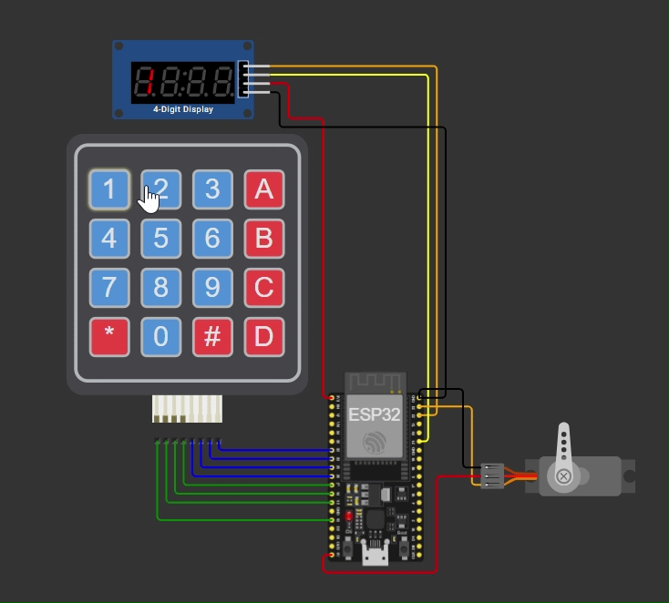

# ESP32 PIN-Zugangssystem

Zugangssystem mit Keypad-PIN-Eingabe, 7-Segment-Anzeige (TM1637) und servogesteuertem Schließmechanismus. Läuft als Simulation in Wokwi, die Firmware ist für den ESP32 geschrieben.

## Funktionsweise

Der Benutzer gibt auf dem 4x4-Keypad einen 4-stelligen PIN ein. Die eingegebenen Ziffern erscheinen live auf der 7-Segment-Anzeige. Nach der vierten Ziffer wird der PIN geprüft:

- **Richtig:** Die Anzeige zeigt `OPEn`, der Servo dreht auf 90° (Schloss offen) und schließt nach 3 Sekunden automatisch wieder.
- **Falsch:** Die Anzeige zeigt `Err`, die Eingabe wird zurückgesetzt.

## Bedienung

| Taste | Funktion |
|-------|----------|
| `0`–`9` | Ziffer eingeben |
| `#` | Letzte Ziffer löschen |
| `*` | Gesamte Eingabe löschen |

Der Standard-PIN in der Simulation lautet `1234`.

## Features

- PIN-Eingabe über 4x4-Matrix-Keypad
- Live-Anzeige der Eingabe auf dem TM1637 (4 Stellen)
- Rückmeldung per Text: `OPEn` bei Erfolg, `Err` bei falschem PIN
- Servo als Schließmechanismus mit automatischem Wiederverschließen
- Korrekturfunktionen (Ziffer löschen, alles löschen)

## Hardware

| Bauteil | Anschluss am ESP32 |
|---------|--------------------|
| ESP32 | – |
| 4x4-Keypad | Zeilen = GPIO 13, 12, 14, 27   Spalten = GPIO 26, 25, 33, 32 |
| TM1637 (7-Segment) | CLK = GPIO 22, DIO = GPIO 21 |
| Servo | Signal = GPIO 23 |

## Setup

1. Projekt in [Wokwi](https://wokwi.com) öffnen (ESP32-Projekt mit den oben genannten Bauteilen).
2. In der Arduino-Umgebung bzw. in Wokwi diese Bibliotheken verwenden:
   - `Keypad`
   - `TM1637Display`
   - `ESP32Servo`
3. Simulation starten und den PIN über das Keypad eingeben.

## Konfiguration

Die Einstellungen stehen am Anfang der Skizze:

| Was | Variable | Standard |
|-----|----------|----------|
| PIN | `PIN_CODE` | `"1234"` |
| PIN-Länge | `PIN_LEN` | `4` |
| Winkel geschlossen / offen | `SERVO_CLOSED` / `SERVO_OPEN` | `0°` / `90°` |
| Offenzeit | `OPEN_TIME_MS` | `3000` ms |

## Demo

### Richtiger PIN

Bei der Eingabe von `1234` zeigt die Anzeige `OPEN` und der Servo öffnet das Schloss.

### Falscher PIN

Bei einem falschen PIN zeigt die Anzeige `Err` und der Servo bleibt geschlossen.

## Sicherheitshinweis

Dieses Projekt ist ein Lern- und Simulationsprojekt. Der PIN steht im Klartext im Quellcode und es gibt keine Sperre nach mehreren Fehlversuchen. Für einen echten Einsatz wären z. B. eine Fehlversuchssperre und eine sichere Speicherung des PINs nötig.

## Lizenz

MIT License

## Hinweis zur KI-Nutzung

Für diese README und um den Code sauberer und effizienter zu machen, habe ich KI (Claude von Anthropic) als Unterstützung verwendet.
